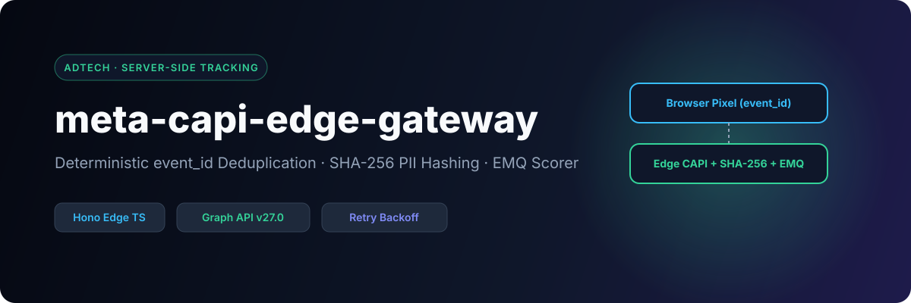
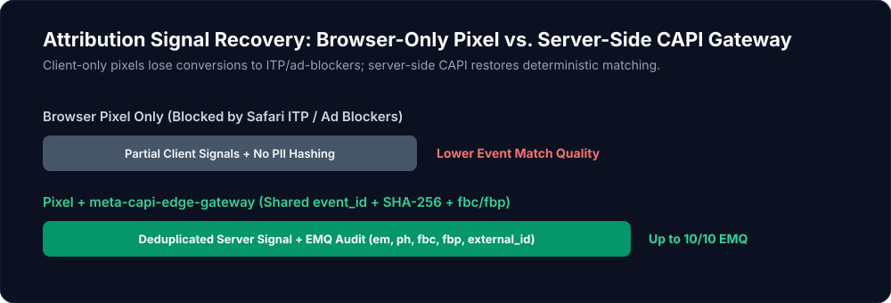
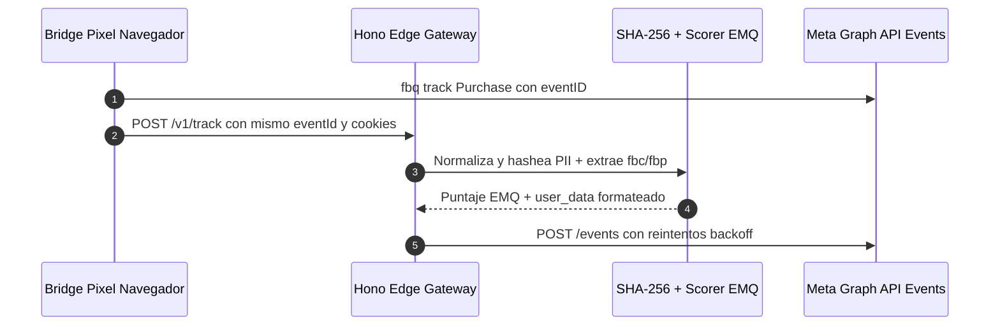

<p align="right">
  <a href="./README.md">🇺🇸 Read in English</a>
</p>

<p align="center">
  
</p>

<p align="center">
  
  
  
  
</p>

# meta-capi-edge-gateway

Gateway ligero y preparado para Edge de **Server-Side Tracking y atribución AdTech** construido con **TypeScript + Hono** para **Meta Conversions API (CAPI)**. Resuelve deduplicación determinista por `event_id` con el Pixel del navegador, normalización y hash **SHA-256** con WebCrypto, extracción automática de `_fbc`/`_fbp`, cálculo previo de **Event Match Quality (EMQ)** y reintentos con *exponential backoff*.

---

## Por qué CAPI Server-Side + Deduplicación

<p align="center">
  
</p>

---

## Flujo de Deduplicación y Envío



---

## Inicio rápido

```bash
git clone https://github.com/stephanocamoretti-dotcom/meta-capi-edge-gateway.git
cd meta-capi-edge-gateway
npm install
cp .env.example .env
# Agrega META_PIXEL_ID y META_ACCESS_TOKEN (o déjalo vacío para modo dry-run)
npm run dev
```

---

## Ideas de escalado para producción

1. **Cloudflare Workers + Queues**: Al usar `Hono` y `webcrypto.subtle` estándar, puedes desplegarlo en Cloudflare Workers y enviar `dispatchCapiEventWithRetry` a una cola asíncrona para no añadir latencia al checkout.
2. **Enrutamiento Multi-Marca para Agencias**: Resuelve `pixelId` y `accessToken` dinámicamente mediante un header `X-Tenant-ID` respaldado por Redis/KV para operar decenas de cuentas desde un solo gateway.
3. **Fan-Out AdTech Unificado**: Replica el payload normalizado hacia **Google Ads Enhanced Conversions**, **TikTok Events API** y tu data warehouse (BigQuery / ClickHouse).
4. **Sincronización CRM / LTV Offline**: Dispara eventos `Purchase` o `Subscribe` directo desde webhooks de Stripe, Shopify o agentes de voz/WhatsApp usando `actionSource: "system_generated"`.

---

## Referencias

- [Meta for Developers — Conversions API: Using the API](https://developers.facebook.com/documentation/ads-commerce/conversions-api/using-the-api)
- [Lanzamiento de Meta Graph API v27.0 y Marketing API v27.0](https://developers.facebook.com/blog/post/2026/11/04/introducing-graph-api-v27-and-marketing-api-v27/)
- [Hono — Framework Web Ultraligero para Edge](https://hono.dev/)
