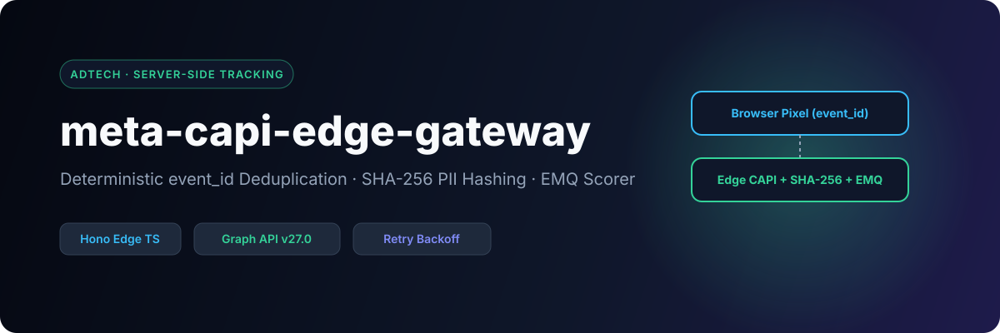
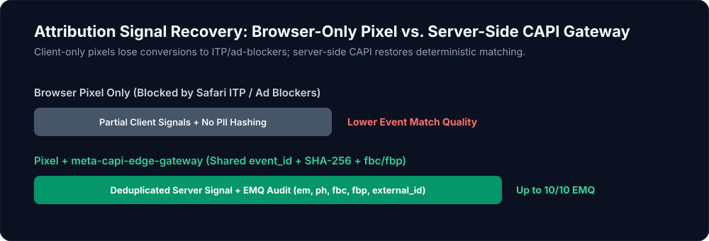
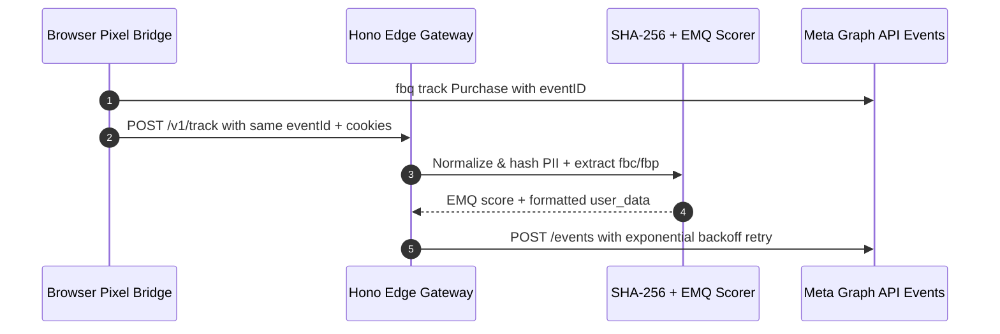

<p align="right">
  <a href="./README.es.md">🇪🇸 Leer en Español</a>
</p>

<p align="center">
  
</p>

<p align="center">
  
  
  
  
</p>

# meta-capi-edge-gateway

A lightweight, edge-ready **Server-Side Tracking & AdTech Attribution Gateway** built with **TypeScript + Hono** for **Meta Conversions API (CAPI)**. It handles deterministic `event_id` deduplication with the browser Meta Pixel, WebCrypto **SHA-256 PII normalization**, automatic `_fbc`/`_fbp` extraction, pre-flight **Event Match Quality (EMQ)** scoring, and exponential-backoff retries.

---

## Why Server-Side CAPI + Deduplication

<p align="center">
  
</p>

---

## Deduplication & Dispatch Flow



---

## Quick Start

```bash
git clone https://github.com/stephanocamoretti-dotcom/meta-capi-edge-gateway.git
cd meta-capi-edge-gateway
npm install
cp .env.example .env
# Add META_PIXEL_ID and META_ACCESS_TOKEN (or leave blank for dry-run EMQ testing)
npm run dev
```

Send a test conversion event:

```bash
curl -X POST http://localhost:8787/v1/track \
  -H "Content-Type: application/json" \
  -d '{
    "eventName": "Purchase",
    "eventId": "ord_9918273",
    "userData": { "email": "Founder@Example.com", "phone": "+1 555-234-5678", "fbclid": "IwAR3demo" },
    "customData": { "currency": "USD", "value": 149.00 }
  }'
```

---

## Scaling Ideas for Production

1. **Cloudflare Workers + Queues**: Because the gateway uses `Hono` and standard `webcrypto.subtle`, deploy it to Cloudflare Workers at the edge and offload `dispatchCapiEventWithRetry` to a Cloudflare Queue for zero-latency checkout responses.
2. **Multi-Account / Agency Routing**: Resolve `pixelId` and `accessToken` dynamically from a `X-Tenant-ID` header backed by Redis/KV so one gateway serves dozens of e-commerce brands.
3. **AdTech Fan-Out**: Mirror the normalized payload from `/v1/track` to **Google Ads Enhanced Conversions**, **TikTok Events API**, and your internal warehouse (BigQuery / ClickHouse) for unified attribution.
4. **Offline / CRM LTV Sync**: Trigger `Purchase` or `Subscribe` events directly from Stripe webhooks, Shopify Flow, or AI Voice/WhatsApp closers using `actionSource: "system_generated"`.

---

## References

- [Meta for Developers — Conversions API: Using the API](https://developers.facebook.com/documentation/ads-commerce/conversions-api/using-the-api)
- [Meta Graph API v27.0 & Marketing API v27.0 Release](https://developers.facebook.com/blog/post/2026/11/04/introducing-graph-api-v27-and-marketing-api-v27/)
- [Hono — Ultrafast Web Framework for the Edges](https://hono.dev/)
